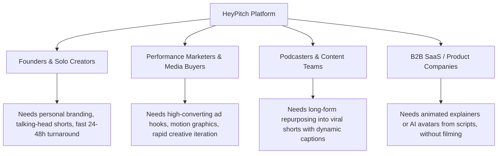
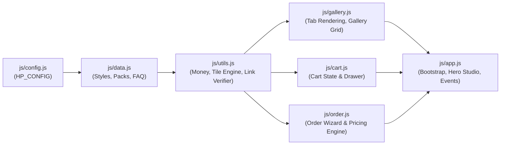
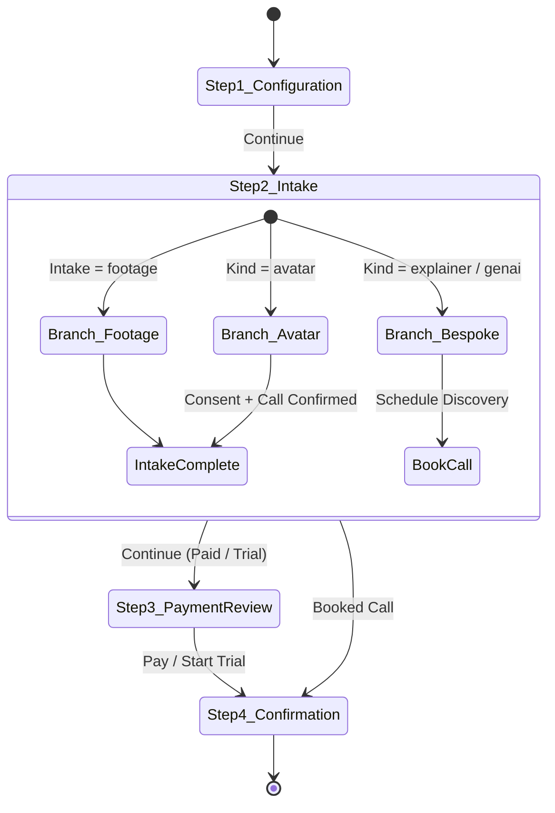
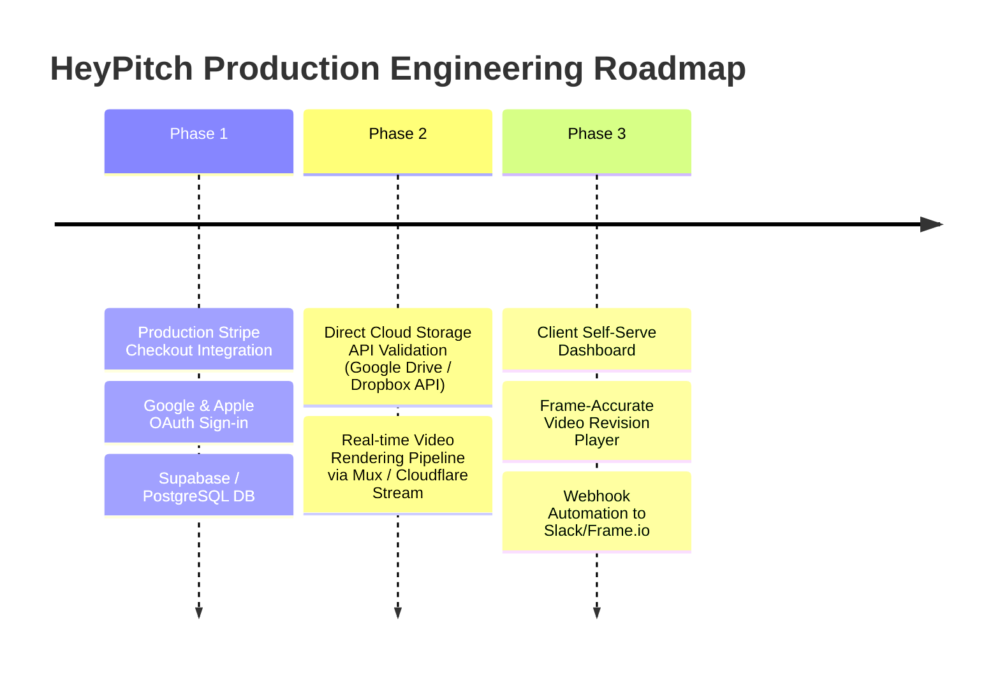

# HeyPitch — Product Requirements Document (PRD)

---

## 1. Document Overview

| Attribute | Details |
| :--- | :--- |
| **Product Name** | **HeyPitch** (HeyPitch Store / Studio) |
| **Document Version** | `v1.0.0` |
| **Status** | Approved / Active Codebase Specification |
| **Target Platforms** | Web (Desktop, Tablet, Mobile Responsive) |
| **Tech Stack** | Vanilla HTML5, Modern CSS3 (Custom Properties, CSS Animations), Vanilla JavaScript (ES6+ Modular) |
| **Primary URL / Domain** | `https://heypitch.in` (Support: `hello@heypitch.in`) |

---

## 2. Executive Summary & Vision

### 2.1 The Problem
Traditional video production and editing agencies suffer from high-friction barriers:
1. **Opaque Pricing:** Requires discovery calls or custom quote requests before seeing prices.
2. **Uncertain Timelines:** Vague turnaround ranges (e.g., "5–10 business days") instead of guaranteed delivery dates.
3. **Mismatch in Expectations:** Clients choose a service without knowing the exact visual style until the first draft is delivered.
4. **Subscription Traps:** "Unlimited" editing retainers with artificial concurrency throttles, hidden caps, and complex onboarding.
5. **Intake Friction:** Chasing file permissions and broken cloud links back-and-forth over email.

### 2.2 The Solution
**HeyPitch** is a **productized video, animation, and AI production platform**. It turns complex creative services into a fast, transparent e-commerce experience:
- **Style-First Selection:** Live animated visual cards show clients the exact typography, motion, and pacing before ordering.
- **Instant Cloud Link Verification:** Validates Google Drive, Dropbox, WeTransfer, and Frame.io permissions and downloadable status before checkout.
- **Fixed Dates & Transparent Costs:** Output duration multipliers, quantity discounts, and guaranteed turnaround dates displayed in real time.
- **Zero-Friction Intake:** Instant 15-second free watermarked trial to capture leads without credit card barriers.
- **Multi-Category Breadth:** Seamlessly spans raw footage editing, repurposing podcasts/clips, motion graphics ads, AI digital twin avatars, animated explainers, and cinematic Gen-AI films.

---

## 3. User Personas & Use Cases



### 3.1 Primary Personas
1. **Founders & Personal Brands:**
   - *Goal:* Consistent, high-fidelity short-form videos for LinkedIn, X, TikTok, and Instagram Reels.
   - *Behavior:* Uses "Cut" or "Clip" styles (e.g., *Quiet*, *Plain*, *Pulse*, *Loud*).
2. **Performance Marketers & Media Buyers:**
   - *Goal:* High-converting UGC, motion graphics hooks, and VSLs.
   - *Behavior:* Orders *Promo*, *Hook*, *Signal*, or bulk packs for ad testing.
3. **Podcasters & Interview Creators:**
   - *Goal:* Cut 20–60 minute recordings into punchy 60s/90s vertical highlights with animated captions.
   - *Behavior:* Orders *Moment*, *Karaoke*, or *Behind Big*.
4. **Lean SaaS / Product Teams:**
   - *Goal:* Product explainers or script-to-video assets without camera equipment or actors.
   - *Behavior:* Uses "Built" styles (*Twin* AI avatar, *Explain* animated explainer, *Film* Gen AI).

---

## 4. System Architecture & Codebase Structure

### 4.1 Directory Map
```
hey-pitch/
├── index.html                   # Primary semantic web application entry point
├── hey-pitch.html updated       # Standalone monolithic legacy/reference prototype
├── css/
│   └── style.css                # Centralized CSS design tokens, typography, layout, animations
├── js/
│   ├── config.js                # Commercial configuration (pricing, currencies, limits, delivery)
│   ├── data.js                  # Data catalogs (styles, categories, families, packs, FAQ)
│   ├── utils.js                 # Helper utilities (currency, pricing calculations, link validator)
│   ├── gallery.js               # Category tabs, filter logic, style grid card rendering
│   ├── cart.js                  # Multi-item cart state, slide-over drawer & checkout simulation
│   ├── order.js                 # 4-step customized order intake wizard & business branching
│   └── app.js                   # Application bootstrap, Hero Maker studio, FAQ, social proof
└── assets/
    ├── images/                  # Static visual assets and posters
    └── videos/                  # Direct MP4 preview clips
```

### 4.2 Script Execution & Dependency Flow


---

## 5. Functional Requirements & Feature Specifications

### 5.1 Hero Product Studio ("The Maker")
The top-of-fold interactive workspace enables immediate engagement without requiring prior sign-up.

- **Dual-Mode Selector:**
  1. **Mode A — "I have footage" (`footage`):**
     - *State 1 (No style selected):* Displays high-conversion **Free Trial Banner** ("Try one edit free — 15s sample, no card") alongside a secondary "Browse the styles" button.
     - *State 2 (Style selected):* Renders selected style badge with quick "Change" trigger, output duration selectors (`Up to 60 sec` vs `Up to 90 sec`), and the instant Cloud Link input box.
  2. **Mode B — "No footage, make it" (`made`):**
     - Displays 3 production categories: **Avatar (*Twin*)**, **Explainer (*Explain*)**, and **Gen AI Film (*Film*)**.
     - Provides interactive sub-options (e.g., Avatar modes: *Talking Head*, *Walking*, *From Photo*, *I have an avatar*).
- **Cycling Dynamic Headline:** Alternates active keywords (`videos`, `shorts`, `podcasts`, `ads`, `explainers`, `avatars`) every 2.4 seconds.
- **Smart CTA Bar:** Contextual hint updates dynamically based on user state (e.g., `"Pulse, up to 60 sec. Add your footage link"` → `"Link checked. Ready to continue"`).

### 5.2 Real-Time Cloud Link Verification Engine
Integrated in both the Hero Maker and the Order Drawer for instant validation:
- **Supported Hosts:** `drive.google.com`, `docs.google.com`, `dropbox.com`, `wetransfer.com`, `we.tl`, `frame.io`.
- **Validation Pipeline:**
  1. **Syntax & Host Check:** Identifies valid cloud storage domain.
  2. **Sharing Permission Check:** Verifies presence of sharing tokens (`usp=sharing`, `dl=0`, `dl=1`, `/share/`).
  3. **Downloadability Inspection:** Flags "View Only" Google Drive URLs that prevent team asset ingestion.
  4. **Source Metadata Extraction:** Reads/simulates duration, size, and format.
  5. **Cap Warning:** Issues a non-blocking warning if source footage exceeds `sourceCapMins` (20 minutes).

### 5.3 Live Style Visualizer & Gallery
- **Tabs & Filters:** *For you*, *Popular*, *Behind the Person*, *Bold*, *Clean*, *Editorial*, *Dynamic*, *Faceless*, *Ads*, *VSL*, *Neon & FX*, *Anything wild*, *No footage*.
- **Pure-CSS Motion Simulation Engine:**
  - `cap.word`: Sequentially highlighted words (`@keyframes hl`).
  - `cap.box`: Popping background boxed keywords (`@keyframes pop`).
  - `cap.behind`: Large background typography positioned behind speaker silhouettes.
  - `cap.karaoke`: Smooth linear gradient wipe across text.
  - `cap.glow`: Neon glow and radial shadows.
  - `cap.serif`: High-contrast editorial serif formatting.
  - Particle & motion overlays: Orbiting rings (`orbit`), equalizer bars (`bars`), and scanlines (`scan`).
- **Hybrid Video Preview Support:** Seamlessly switches from CSS animation to HTML5 `<video autoplay loop muted playsinline>` when an explicit `preview` MP4 URL is configured in `HP_CONFIG.styles`.
- **Badging:** "TRENDING", "NEW", and "Crown" (Pro/Premium) ribbons.

### 5.4 Order & Checkout Drawer Wizard (4 Steps)
A slide-over modal drawer manages multi-step ordering with specialized workflows:



- **Step 1: Configuration & Quantity**
  - Select output length (`s60` vs `s90`).
  - Select volume quantity (`1`, `5`, `10`, `20`) with automatic tiered discounts.
  - Multi-style toggle (`Same style for all` vs `Mix styles`).
  - Purpose tag selection (`Personal branding`, `Paid ads`, `VSL`, `Content`, `Product`, `Other`).
  - Optional Add-on: Second revision round (+35% base price).
  - Dynamic turnaround date estimation based on quantity.
- **Step 2: Intake & Assets**
  - *Footage Flow:* Paste cloud URL with real-time download validation, optional brand kit link, handles/posting channels, and creative notes.
  - *Avatar Flow:* Mandatory digital likeness legal consent checkbox, verification call availability checkbox, and script input.
  - *Explainer & Gen-AI Flow:* Product brief, core value statement ("The one thing the viewer must understand"), and direct calendar call booking.
  - *Free Trial Flow:* Streamlined 15-second sample brief.
- **Step 3: Review & Payment**
  - Itemized invoice breakdown showing style, length, quantity, build fees, and revision add-ons.
  - Frictionless authentication (Email for passwordless dashboard magic link + "Continue with Google").
  - Watermark removal upsell for free trials ($12).
  - Add to Cart or direct checkout trigger.
- **Step 4: Confirmation & Order Queue**
  - Unique Order ID generation (`HP-####`).
  - Live status chips (`Footage received`, `Waiting for footage`, `Brief received`, `Free trial`).
  - Calendar booking embed for avatar verification or explainer scoping calls.

### 5.5 Cart & Multi-Item Order Management
- Persistent slide-over cart accessible via header badge.
- Supports mixed carts containing individual video styles and monthly subscription credit packs.
- Item removal, total price computation, and single-click checkout.

### 5.6 Monthly Subscription Credit Packs
A credit-based recurring subscription model for high-frequency clients:
- **Single (Pay-per-video):** Pay as you go at base card price.
- **Ten Pack ($1,190/mo):** 10 credits ($119/video), saved brand kit, priority queue, 90-day credit validity, limited monthly slot counter.
- **Thirty Pack ($3,290/mo):** 30 credits ($110/video), 2 concurrent active videos, dedicated producer, 2 revision rounds, white-label availability.

### 5.7 Social Proof & Conversion Triggers
- **Asynchronous Purchase Toast:** Periodic unobtrusive popup (every 14s) showing recent global orders with anonymized company names (e.g., *"Josefa from Bright\*\*\*\* ordered an AI avatar video · Austin · 2 min ago"*).
- **Interactive FAQ Accordion:** Clean animated expand/collapse for core operational questions.
- **Competitive Comparison Matrix:** Side-by-side breakdown comparing "Elsewhere" (freelancers/unlimited agencies) vs "HeyPitch".

---

## 6. Data Models & Configuration Specifications

### 6.1 `HP_CONFIG` Schema
```typescript
interface HeyPitchConfig {
  brand: string;
  currencies: Record<string, CurrencyDefinition>;
  defaultCurrency: string;
  geoToCurrency: Record<string, string>;
  showCurrencyPicker: boolean;
  durationTiers: DurationTier[];
  sourceCapMins: number;
  trial: {
    seconds: number;
    removeLogo: number;
    enabled: boolean;
  };
  delivery: {
    base: string;
    tiers: { max: number; text: string }[];
    callThreshold: number;
    callPromise: string;
  };
  purposes: { id: string; label: string }[];
  proof: ProofItem[];
  quantities: number[];
  quantityDiscount: Record<number, number>;
  revisionAddon: number;
  avatarModes: AvatarMode[];
  cycleWords: string[];
}
```

### 6.2 Style Entity Schema (`HP_CONFIG.styles`)
```typescript
interface VideoStyle {
  id: string;                      // Unique slug (e.g., 'pulse', 'twin')
  fam: "cut" | "clip" | "motion" | "built"; // Family grouping
  name: string;                    // Human-readable title
  mood: string;                    // Subtitle description
  price: number;                   // Base USD price (at 60s tier)
  credits: number;                 // Consumed pack credits
  days: number;                    // Base turnaround working days
  bg: string;                      // CSS background class
  cap: "line" | "word" | "box" | "behind" | "glow" | "serif" | "karaoke"; // Caption animation class
  text: string;                    // Display sample text (HTML enabled)
  tag?: string;                    // Badge label (e.g., 'Popular', 'Ads', 'Avatar')
  badge?: "trend" | "new" | null;  // Corner ribbon
  pro?: boolean;                   // Crown icon indicator
  cat: string[];                   // Category membership IDs
  shortform?: boolean;             // Enables duration tier scaling
  preview?: string;                // Direct MP4 or Base64 data URL
  poster?: string;                 // Video poster thumbnail
  build?: number;                  // One-time avatar setup fee
  kind?: "avatar" | "explainer" | "genai"; // Bespoke pipeline discriminator
  call?: boolean;                  // Triggers discovery call booking flow
  extra?: "shape" | "bars" | "orbit" | "scan"; // Overlay CSS elements
}
```

---

## 7. Business Logic & Pricing Engine

### 7.1 Pricing Formulas
1. **Base Style Unit Price:**
   $$\text{Unit}(\text{Style}, \text{Len}) = \begin{cases} \text{Style.Price} \times \text{Tier.mult}, & \text{if shortform} = \text{true} \\ \text{Style.Price}, & \text{otherwise} \end{cases}$$
2. **Discounted Unit Price for Volume:**
   $$\text{DiscountedUnit} = \text{Unit}(\text{Style}, \text{Len}) \times (1 - \text{Discount}(\text{Qty}))$$
   *Discounts:* $1 \to 0\%,\; 5 \to 8\%,\; 10 \to 15\%,\; 20 \to 22\%$
3. **Revision Add-on:**
   $$\text{RevisionFee} = \text{Round}\big(\text{Unit}(\text{Style}, \text{Len}) \times 0.35\big) \times \text{Qty}$$
4. **Total Order Calculation:**
   $$\text{OrderTotal} = (\text{DiscountedUnit} \times \text{Qty}) + \text{RevisionFee} + \text{BuildFee}$$
   *(Note: Build fee is waived if `avatarMode === 'have'`)*
5. **Currency Localizer:**
   $$\text{ConvertedPrice} = \text{RoundToMultiple}\left(\frac{\text{USD} \times \text{Rate}}{\text{RoundFactor}}\right) \times \text{RoundFactor}$$

---

## 8. Design System & UI/UX Standards

| Token Category | Value / Variable | Description |
| :--- | :--- | :--- |
| **Dark Theme Backgrounds** | `--bg`: `#0A0812`, `--bg2`: `#0F0B19`, `--surface`: `#15101F`, `--surface2`: `#1B1529` | Deep obsidian & violet dark surfaces |
| **Borders & Dividers** | `--line`: `#2A2140`, `--line2`: `#3A2E5A` | Subtle high-contrast purple dividers |
| **Accent & Brand** | `--violet`: `#7C5CFF`, `--violet2`: `#4A2FC2`, `--violet3`: `#B9A6FF` | Electric purple primary brand identity |
| **Glow Effect** | `--glow`: `rgba(124,92,255,0.35)` | Neon atmospheric glow on cards & CTAs |
| **Status Colors** | `--ok`: `#5EE0A0`, `--warn`: `#FFB86B`, `--bad`: `#FF6B8B` | Link check, badges & system alerts |
| **Typography** | Display: `Bricolage Grotesque`<br>Body: `Instrument Sans` | Modern, distinctive typography pairing |
| **Border Radii** | `--r-s`: `8px`, `--r-m`: `14px`, `--r-l`: `22px` | Modern smooth rounded cards and pills |
| **Breakpoints** | Desktop: `>1040px`, Tablet: `720px - 1040px`, Mobile: `<720px` | Responsive fluid layouts and bottom sheets |

---

## 9. Non-Functional Requirements

1. **Performance & Lightweight Footprint:**
   - Zero heavyweight external JS framework dependencies (pure native DOM manipulation).
   - Video previews lazy-loaded with `preload="metadata"`.
   - CSS-only animations for mockups ensure 60fps performance on all low-power mobile devices.
2. **Accessibility (a11y):**
   - High contrast ratios (light text on dark backgrounds).
   - Full keyboard navigation with `:focus-visible` styling (`outline: 2px solid var(--violet3)`).
   - Semantic ARIA attributes on modals (`aria-hidden`), drawers, and accordion buttons (`aria-expanded`).
   - `prefers-reduced-motion` compliance to disable kinetic animation for sensitive users.
3. **Regional Geolocation:**
   - Automatic currency and regional rate mapping via `window.__REGION` server-injected variable with fallback to `Intl.DateTimeFormat` / browser locale.

---

## 10. Future Roadmap & Production Integrations



1. **Payment Gateway Integration:** Connect `payCart` and `pay` action triggers to live **Stripe Elements / Checkout Sessions**.
2. **Authentication Engine:** Implement passwordless magic links and OAuth (Google / Apple) via Supabase or Firebase Auth.
3. **Production Cloud Link Ingestion:** Replace simulated `verifyLink` timeout with a serverless backend API that queries Google Drive API and Dropbox API to verify OAuth access and true file sizes.
4. **Client Portal / Delivery Dashboard:** Real-time kanban tracking showing order statuses: `In Queue` $\to$ `Scripting` $\to$ `Editing` $\to$ `Review Ready` $\to$ `Delivered`.
5. **Interactive Video Review Player:** Frame-accurate revision commenting tool directly on delivered draft videos.
